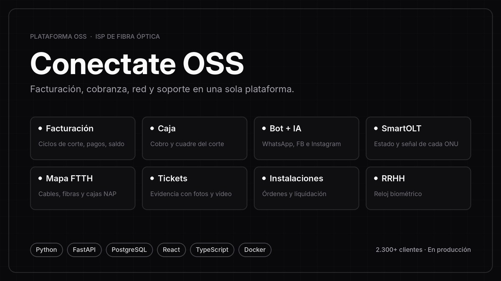
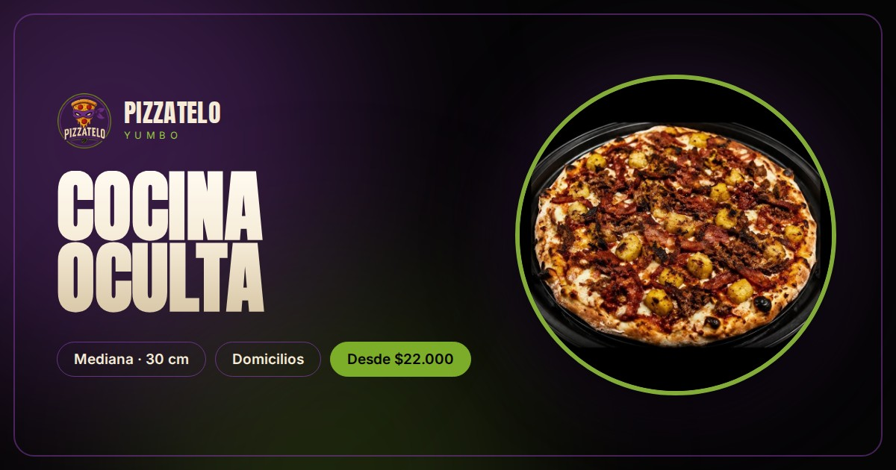

# Juan David Garzón

**Desarrollador Fullstack** · Yumbo, Valle del Cauca, Colombia

---

Construyo software completo — de la idea al producto funcionando en producción para empresas reales.

Diseño y construyo plataformas empresariales que operan en producción todos los días. Trabajo con **Clean Architecture, DDD, POO y principios SOLID**, con **TDD** estricto y un flujo **SDD** (propuesta → spec → diseño → tareas), apoyado en agentes de IA con **Claude Code**.

---

## Experiencia

**Desarrollador Full Stack** · Conéctate Telecomunicaciones · Yumbo
 Jun 2026 — Actualidad

- Diseño y desarrollo de **Conectate OSS**, la plataforma con la que opera la empresa: un monolito modular con Clean Architecture y DDD, construido con TDD y desplegado con Docker.
- Migración de la facturación desde un sistema de terceros a una solución propia.
- Atención omnicanal con Meta (WhatsApp, Facebook e Instagram), Chatwoot y n8n, con un asistente que responde a los clientes con datos reales de la plataforma.
- Integraciones con pasarelas de pago, gestión de red y telefonía IP.
- Desarrollo asistido por agentes de IA (Claude Code), con revisión y control de calidad en cada entrega.

---

## Educación

**Tecnología en Desarrollo de Software** · Universidad del Valle
 2022 — 2026

- Reconocido como mejor graduando del programa.

---

## Stack

  

---

## Proyectos en producción

<table>
  <tr>
    <td width="45%">
      
    </td>
    <td width="55%" valign="top">
      <h3>Conectate OSS</h3>
      
Plataforma de gestión operativa para un proveedor de internet por fibra óptica, diseñada y construida desde cero y en uso diario en producción.

      <ul>
        <li>Facturación, cobranza y pagos en línea</li>
        <li>Clientes, soporte técnico, instalaciones e inventario</li>
        <li>Documentación de la red de fibra óptica</li>
        <li>Atención omnicanal con Meta, Chatwoot y n8n, con asistente que responde con datos reales</li>
        <li>Arquitectura multiempresa con control de acceso por roles</li>
      </ul>
      
<code>Python</code> <code>FastAPI</code> <code>PostgreSQL</code> <code>React</code> <code>TypeScript</code> <code>Docker</code> <code>n8n</code> <code>Chatwoot</code>

      
En producción · Empresa real · Plataforma privada

    </td>
  </tr>
  <tr>
    <td width="45%">
      
    </td>
    <td width="55%" valign="top">
      <h3>Gessat</h3>
      
Plataforma para que las empresas colombianas lleven su SG-SST: gestión de documentos de seguridad y salud en el trabajo, capacitaciones para sus trabajadores y pagos integrados con Wompi.

      
<code>React</code> <code>Vite</code> <code>Python</code> <code>PostgreSQL</code> <code>Wompi</code> <code>TailwindCSS</code>

      
En producción · Cliente real

      
    </td>
  </tr>
  <tr>
    <td width="45%">
      
    </td>
    <td width="55%" valign="top">
      <h3>Pizzatelo</h3>
      
Menú web interactivo para Pizzatelo Yumbo: catálogo de pizzas con filtros, buscador, ficha de detalle, métodos de pago y pedido directo por WhatsApp.

      
<code>Next.js</code> <code>TypeScript</code> <code>TailwindCSS</code> <code>SSG</code>

      
En producción · Cliente real

      
    </td>
  </tr>
</table>

---

## Stats

  

---

[Portafolio](https://portafolio-umber-xi.vercel.app) · [LinkedIn](https://linkedin.com/in/davidgarzondev/)

